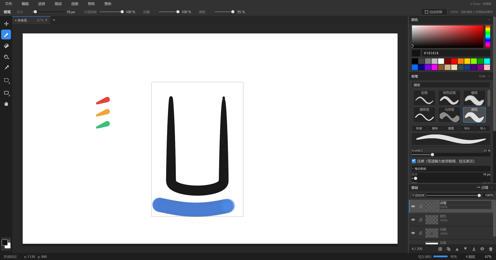
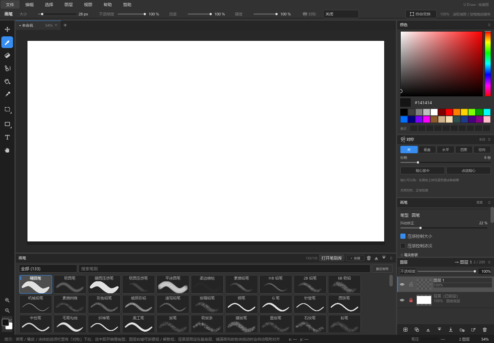

<div align="center">

# U Draw

**一个只做绘画的轻量 Windows 绘画软件**

界面语言与配色致敬 PhotoCraft / Photoshop，用 Python + PySide6 从零重写

[](LICENSE)
[](https://www.python.org/)
[](https://pypi.org/project/PySide6/)
[](#系统要求)
[](#)

[功能](#功能) · [快速开始](#快速开始) · [快捷键](#快捷键速查) · [项目结构](#项目结构) · [打包](#从源码打包) · [致谢](#致谢与血缘)

</div>

---

## 这是什么

U Draw 是一个**专注绘画本身**的桌面绘图软件：没有修图、调色、滤镜、AI 那一整套，只留下画笔、橡皮、涂抹、选区、文字、图层和压感。

- **60 MB 级体积、1 秒内启动**，不需要独立显卡（纯 CPU 光栅绘制）
- **102 支内置笔刷 / 13 个分类 / 23 种笔型**，每支笔的缩略图都是用真引擎画出来的试笔样品
- **22 项独立笔刷参数**，分六组可折叠；所有滑块不响应滚轮，不会误改数值
- **真压感**：数位板有真实压力就优先用，没有就按运笔速度模拟，状态栏一眼看出走的是哪条路
- **图层组、自由变换、多文档标签、多窗口、PSD 分层导出**这些重活也都在



## 功能

### 绘画

| | |
|---|---|
| **笔刷引擎** | 自研，22 项参数分「笔尖形状 / 形状动态 / 传递 / 纹理 / 颜色动态 / 笔锋」六组。铅笔带纸纹、蜡笔边缘毛糙、圆珠笔硬边等粗、马克笔扁头平涂、水彩有湿边、喷枪散点、油画笔是一排鬃毛 |
| **笔刷预设条** | 画布下方平铺网格，竖向滚动常显；悬停弹出大图试笔，右键重命名 / 导出 / 删除，末尾虚线格一键新建 |
| **抖动修正** | 一根滑杆，「绳子牵引」原理；60% 以上会把本来就直的笔迹吸附成真正的直线，画弯的地方不受影响 |
| **压感** | 开关式。开启＝随力度变粗变细、轻压更淡；关闭＝等粗线（圆珠笔 / 马克笔） |
| **对称** | 垂直 / 水平 / 四象限 / 径向（2~24 份）。每颗笔点按轴展开，压感 / 抖动 / 颗粒都真镜像；参考线与轴心十字自动显示，轴心可直接在画布上拖 |
| **涂抹** | `S`，默认力度 20%，大小 / 硬度独立，过渡按笔点间距归一化，不会一步叠死成分层色带 |



### 图层与文档

- **最多 200 个图层**，独立不透明度 / 显示 / 锁定；拖动行直接排序，双击改名，背景层固定最底层
- **图层组**：`Ctrl+G` 编组、`Ctrl+Shift+G` 解散，图层与文字行都能拖进拖出
- **多文档标签**：新建 / 打开 / 导入都开新标签，各自保留缩放位置与撤销记录；标签拖出窗口 = 独立窗口，拖回去 = 合并
- **无限撤销 / 重做**：每步只存笔迹的脏矩形，很省内存
- **自由变换**：`Ctrl+T`，旋转 / 缩放 / 翻转，**变换出画布的内容不会丢**，缩回来就恢复
- **选区**：矩形 / 椭圆 / 套索合一，`Shift` 加选、`Alt` 减选，蚂蚁线动画，自动限制绘画与填充范围
- **文字对象**：就地打字、所见即所得，落字后仍是可再编辑的「文字对象」而不是像素，不占图层名额

### 输入与输出

- **工程文件 `.pcdraw`**：分层保存，可再编辑；安装包注册了文件关联，双击直接打开
- **导出 PSD**：手写的 PSD 写入器（8BPS / RGB / 8bit / 4 通道 / PackBits RLE，**零第三方库**），图层顺序、位置、名称（含中文）、可见性、不透明度、透明通道、合成图全部保留，Photoshop / GIMP / Krita / Affinity 都能直接打开
- **导出 PNG / JPG**、拖入图片成新图层、跨文档 / 跨软件剪贴板

### 手感细节

- 200% 以上按**像素清晰**显示（和 PS 放大看像素一致），200% 以下自动平滑
- 运笔期间不跑任何后台刷新（图层缩略图防抖、悬停看门狗都只在没在画时才动）
- 抬笔只更新当前层缩略图，40 层文档抬笔约 30 ms
- 工作区每条分隔条都能拖，调完自动记住，重启还是上次的样子

## 系统要求

| | 最低（能流畅画） | 推荐 |
|---|---|---|
| 系统 | Windows 10 64 位 | Windows 10 / 11 64 位 |
| CPU | 双核四线程（i3-6100 / i5-7200U 级） | 四核（i3-8100 / i5-8250U 级及以上） |
| 内存 | 4 GB | 8 GB |
| 硬盘 | 400 MB 可用 | 1 GB 可用（建议 SSD） |
| 显卡 | 集成显卡即可 | 集成显卡 |

内存估算：`180 MB + 宽 × 高 × 4 字节 × 图层数`。1600×1200 画 10 层约 260 MB。

## 快速开始

### 直接用（不需要 Python）

到 [Releases](../../releases/latest) 下载 `U-Draw-Setup-<版本>.exe`，双击安装。默认装到 `%LOCALAPPDATA%\Programs\U Draw`，**不需要管理员权限**。

静默安装：

```bash
"U Draw Setup 2.15.41.exe" --silent --dir="D:\Apps\U Draw" --no-desktop --no-startmenu
```

### 跑源码

```bash
git clone https://github.com/<your-name>/U-Draw.git
cd U-Draw
pip install -r requirements.txt
python main.py
```

源码版还支持几个自测开关：

```bash
python main.py --source        # 源码模式启动
python main.py --brush-demo    # 笔刷试笔模式
python main.py --bench 结果.txt # 跑性能基准
```

### 跑自测

仓库里带着一整套回归脚本，不需要额外测试框架：

```bash
python _selftest.py            # 18 项功能自测
python _test_app_smoke.py      # 11 项主窗口冒烟（真建窗口走一遍）
python _test_copy_paste.py     # 15 项复制粘贴回归
python _test_stamp_start.py    # 印章笔起笔只落一颗
python _brushlib_audit.py      # 全库每支笔都能出墨 + 渲染样张
```

## 快捷键速查

| 工具 | | 画布 | |
|---|---|---|---|
| `B` | 画笔 | 空格 + 拖 / 中键拖 | 移动画布 |
| `E` | 橡皮 | 滚轮 | 以光标为中心缩放 |
| `S` | 涂抹 | `Ctrl+0` / `Ctrl+1` | 适应窗口 / 100% |
| `G` | 油漆桶 | `[` / `]` | 笔刷缩小 / 放大 |
| `I` | 吸管 | `Ctrl` + 滚轮 | 调笔刷大小 |
| `T` | 文字 | `X` | 交换前景 / 背景色 |
| `V` | 移动 | | |
| `U` | 形状 | `Ctrl+N` / `O` / `S` | 新建 / 打开 / 保存 |
| `M` / `L` | 选区 / 套索 | `Ctrl+Alt+S` | 导出图片 |
| `H` | 抓手 | `Ctrl+Z` / `Ctrl+Y` | 撤销 / 重做 |
| | | `Ctrl+T` | 自由变换 |
| | | `Ctrl+G` / `Ctrl+Shift+G` | 编组 / 解散组 |
| | | `Ctrl+E` | 向下合并 |
| | | `Ctrl+Shift+N` / `Ctrl+J` | 新建 / 复制图层 |
| | | `Ctrl+D` / `Ctrl+A` / `Ctrl+Shift+I` | 取消 / 全选 / 反选 |

完整说明见 [docs/使用说明.md](docs/使用说明.md)。

## 项目结构

```
.
├─ main.py              入口（窗口图标、深色标题栏、--screenshot / --bench）
├─ main_window.py       主窗口：菜单、选项栏、工具栏、状态栏、各种命令
├─ canvas.py            画布视图：绘画 / 涂抹 / 对称 / 文字 / 压感 / 平移缩放 / 选区 / 光标
├─ core.py              文档 / 图层 / 笔刷引擎 / 撤销 / 填充 / 存取（不含任何界面）
├─ brushes.py           笔刷定义与 102 支内置预设
├─ panels.py            右侧面板：颜色、笔刷、对称、图层
├─ brush_library_view.py 笔刷库与预设条
├─ text_tool.py         画布上的就地文字编辑框
├─ psd_export.py        纯手写 PSD 写入器（RLE 压缩，无第三方库）
├─ fonts.py             文字库：内置字体注册 + 系统字体清单
├─ theme.py             配色与 QSS（值取自 Pro Dark）
├─ icons.py             纯代码矢量图标
├─ about_dialogs.py     「关于」与「赞助」对话框
├─ installer.py         安装向导逻辑
├─ build_exe.py         PyInstaller 打包
├─ build_installer.py   把 exe 塞进安装向导
├─ assets/
│  ├─ fonts/            4 套 OFL 字体 + 授权文件
│  └─ qr_*.png          赞赏码
├─ docs/                使用说明与截图
└─ _test_*.py           回归脚本
```

`core.py` 刻意不依赖任何界面控件，移植到别的 UI 层（比如移动端）时可以直接复用，只需替换 `canvas.py` + `panels.py`。

## 从源码打包

需要 PySide6 + numpy + pyinstaller：

```bash
pip install -r requirements.txt pyinstaller
python build_exe.py            # → 上级目录 "U Draw.exe" + "U Draw" 目录版
```

再打安装包（安装向导用 tkinter，需要带 tkinter 的 Python 解释器）：

```bash
python build_installer.py      # → 上级目录 "U Draw Setup <版本>.exe"
```

## 已知限制

- **仅 Windows**。大量使用了 Win32 原生接口（深色标题栏 `dwmapi`、文件关联注册表、安装向导），跨平台需要另做一层抽象
- **图层混合模式只有「正常」**，这是刻意的取舍：绘画用不上，去掉能省掉一整条合成分支
- **PSD 导出不含图层组**：组会按 z 序摊平成普通图层（PSD 的 `lsct` 段成本高收益低），也不含文字层与蒙版
- 200% 以上的「像素清晰」显示在超大画布上会略吃 CPU，属于预期行为

## 致谢与血缘

U Draw 衍生于 **[PhotoCraft 0.12.0](https://getartcraft.com/apps/photocraft)** —— ArtCraft 开源发布的 Photoshop 复刻（MIT / Apache-2.0 双许可，100% Rust 编写）。

本项目的做法是：**以 PhotoCraft 的界面语言与 Pro (Dark) 配色为参照，用 Python + PySide6 重新实现一个只含绘画功能的原生版本**，不包含 PhotoCraft 的任何源代码。原项目名称与商标归 ArtCraft 所有，本软件与其无隶属关系，也不代表其立场。

内置字体（BIZ UDMincho / BIZ UDPGothic / Shippori Mincho）来自 Google Fonts，遵循 SIL Open Font License 1.1，授权原文随字体一起放在 `assets/fonts/`。

## 赞赏支持

如果这个软件对你有用，欢迎请作者喝杯咖啡。二维码在软件内「赞助」菜单里，也在 `assets/` 下。

## 许可证

[MIT](LICENSE) © 2026 宇

你可以自由使用、修改、分发、商用，只需保留版权声明与许可声明。

PySide6（LGPL-3.0）、NumPy（BSD-3-Clause）与内置 OFL 字体的授权细节见 [THIRD-PARTY-NOTICES.md](THIRD-PARTY-NOTICES.md)。
